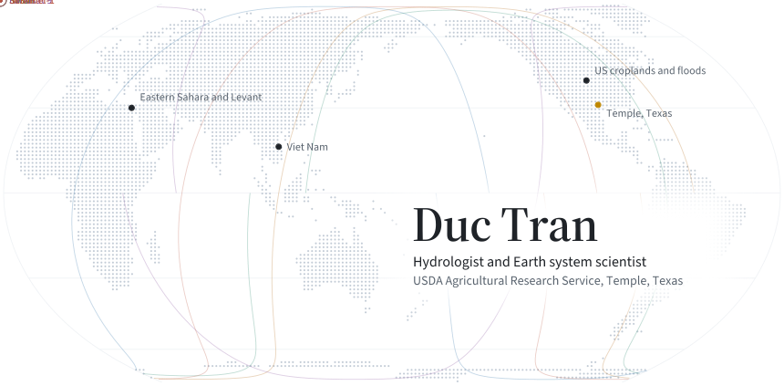
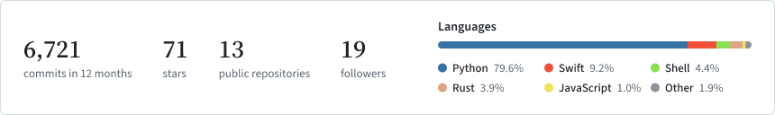

<picture>
  <source media="(prefers-color-scheme: dark)" srcset="./assets/banner-dark.svg">
  
</picture>

  <a href="https://ductran96.com">Website</a> ·
  <a href="https://scholar.google.com/citations?user=tIcTCNgAAAAJ&hl=en">Google Scholar</a> ·
  <a href="https://orcid.org/0000-0001-8478-5893">ORCID</a> ·
  <a href="https://www.linkedin.com/in/thanh-nhan-duc-tran/">LinkedIn</a> ·
  <a href="mailto:duc.dut.wr@gmail.com">duc.dut.wr@gmail.com</a>

I am a hydrologist at the USDA Agricultural Research Service in Temple, Texas. I build and run Earth system models, from SONTINH, my GPU flood model for the conterminous United States, and the water budget of single crop fields to dust storms over the deserts of the Middle East, and I tie them to satellite observations and machine learning. Ph.D. in Civil Engineering, University of Virginia.

<picture>
  <source media="(prefers-color-scheme: dark)" srcset="./assets/metrics-dark.svg">
  
</picture>

## Research

- **SONTINH**, a GPU 2-D flood model for the conterminous United States, run on floods such as hurricanes Harvey, Beryl and Florence
- Field scale evapotranspiration and irrigation across US croplands (SWAT+, OpenET)
- Assimilation of SMAP soil moisture into watershed models
- Desert dust and aerosol over North Africa and the Levant with WRF-Chem
- Floods, drought and drought recovery seen from space

## Technical skills

<picture>
  <source media="(prefers-color-scheme: dark)" srcset="./assets/skills-dark.svg">
  
</picture>

## GitHub

<picture>
  <source media="(prefers-color-scheme: dark)" srcset="./assets/github-dark.svg">
  
</picture>

## Education and recognition

- **Ph.D.** Civil Engineering, University of Virginia
- **M.Sc.** Hydroinformatics, Erasmus Mundus (five countries)
- **B.Eng.** Hydraulic Engineering, University of Danang
- Winner, NASA and AGU Michael H. Freilich Student Data Visualization Competition
- Summer Fellow, NOAA National Water Center (2024)
